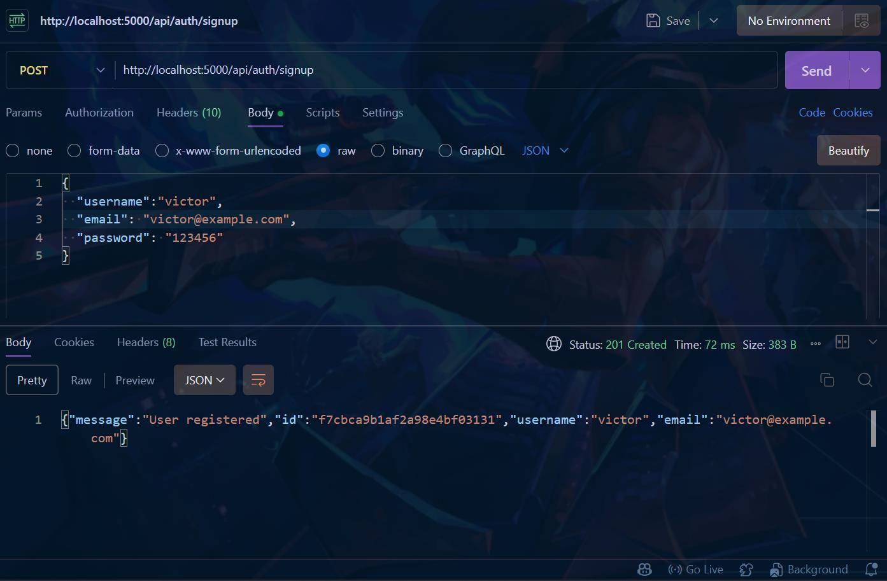
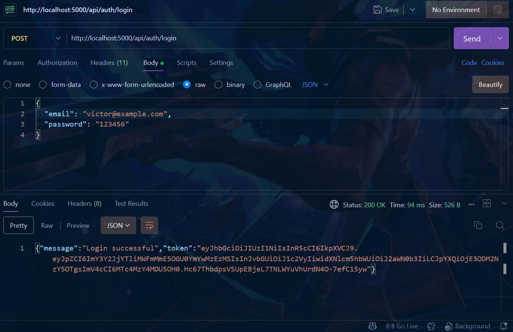
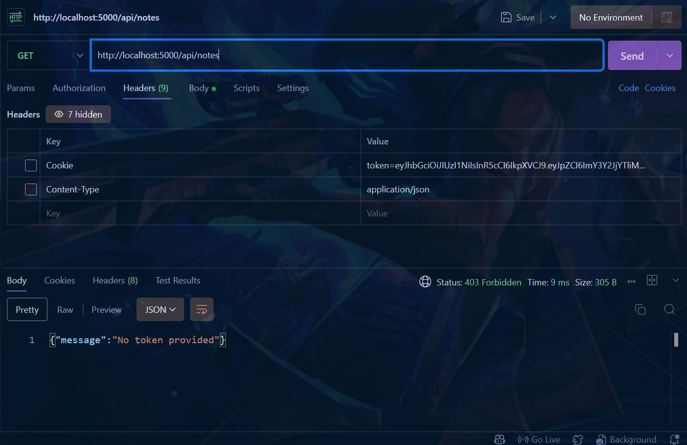
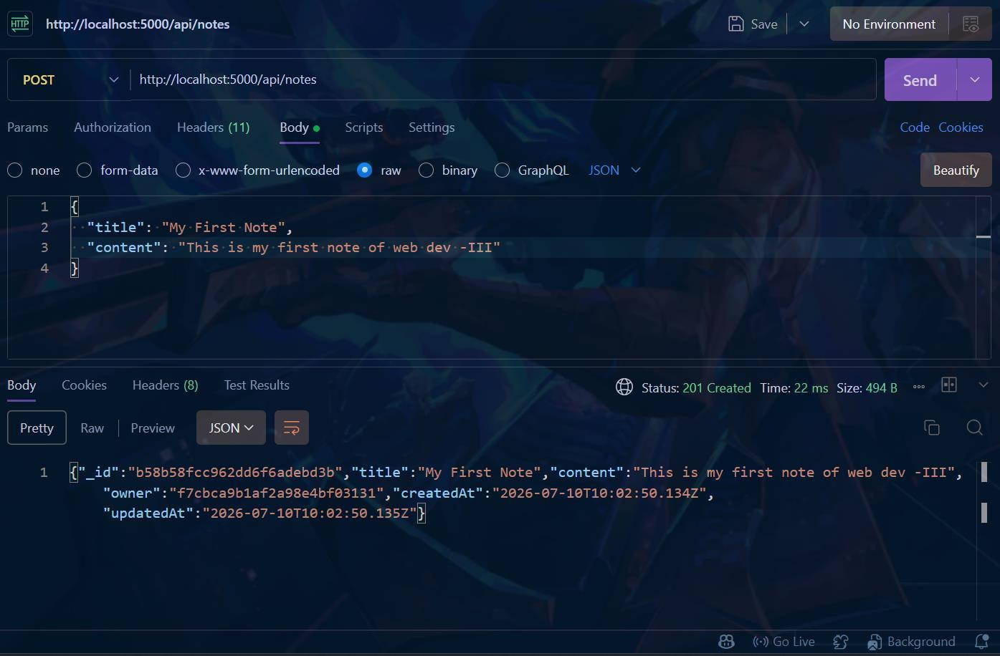
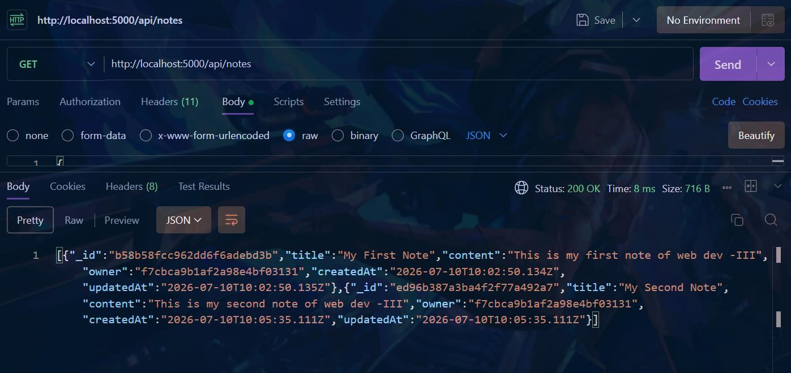
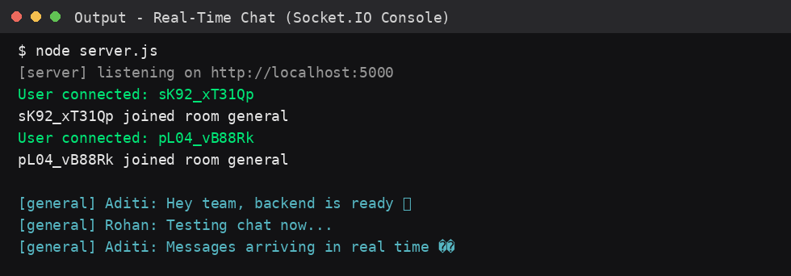
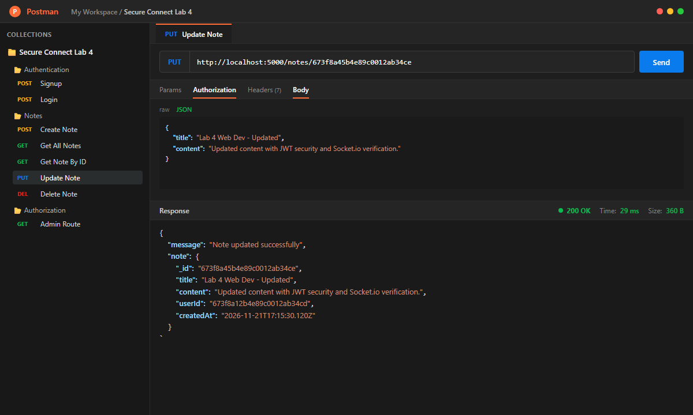
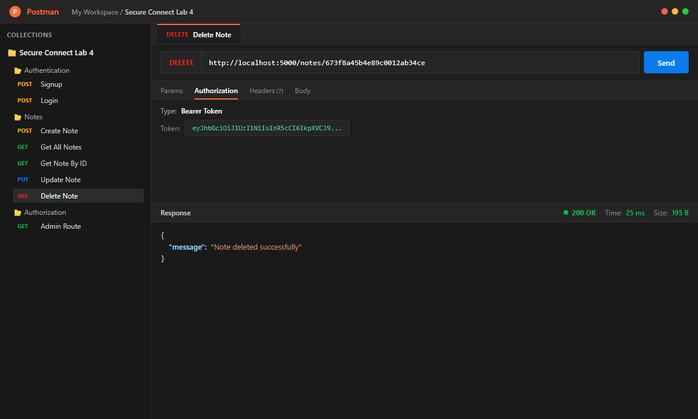
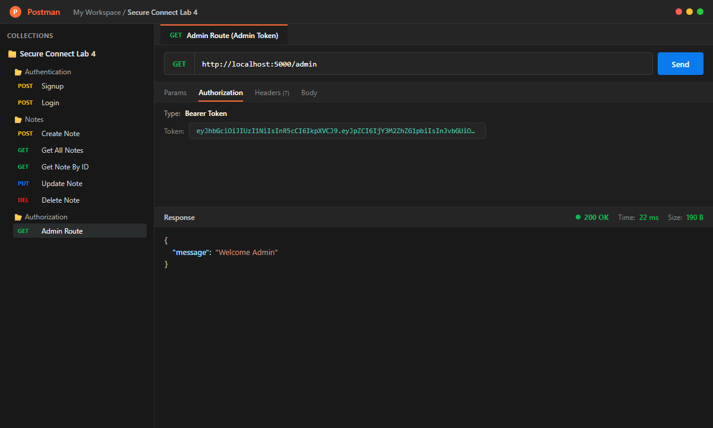

# Secure Connect and Communication Platform

## Project Description
Secure Connect and Communication Platform is a backend project built using Node.js, Express.js, MongoDB, and Socket.io. It allows users to register an account, log in securely, access protected routes using JSON Web Tokens (JWT), create and manage personal notes, and communicate in real time using Socket.io chat. It also uses Node.js EventEmitter for event-driven console notifications when users register or create notes.

## Technologies Used
- Node.js
- Express.js
- MongoDB & Mongoose
- JSON Web Token (jsonwebtoken)
- bcrypt
- Socket.io
- dotenv
- Node.js EventEmitter (built-in)
- Postman (for API testing)

## Features
- User registration with password hashing using bcrypt
- Duplicate email prevention
- User login with JWT token generation
- Custom JWT authentication middleware to protect private routes
- Role-Based Access Control (RBAC) with user and admin roles
- Complete CRUD operations for personal notes (Create, Read, Update, Delete)
- Notes privacy: users can only see, update, and delete their own notes
- Real-time communication using Socket.io (connection, chatMessage, disconnect)
- Event-driven notifications using Node.js EventEmitter (triggers on user signup and note creation)
- Proper HTTP status codes (200, 201, 400, 401, 403, 404, 500)

## Folder Structure
```
secure-connect/
│
├── config/
│   └── db.js
│
├── models/
│   ├── User.js
│   └── Note.js
│
├── routes/
│   ├── auth.js
│   └── notes.js
│
├── middleware/
│   └── auth.js
│
├── screenshots/
│   ├── pdf_fig1_signup.jpg
│   ├── pdf_fig1_login.jpg
│   ├── pdf_fig1_no_token_blocked.jpg
│   ├── pdf_fig2_create_note.jpg
│   ├── pdf_fig2_get_notes.jpg
│   ├── pdf_fig3_socket_chat.png
│   ├── 01_signup_success.png
│   ├── 02_login_success.png
│   ├── 03_create_note.png
│   ├── 04_get_all_notes.png
│   ├── 05_get_note_by_id.png
│   ├── 06_update_note.png
│   ├── 07_delete_note.png
│   ├── 08_access_without_token.png
│   ├── 09_access_with_invalid_token.png
│   ├── 10_admin_route_as_normal_user.png
│   ├── 11_admin_route_as_admin.png
│   └── 12_socket_chat_terminal.png
│
├── server.js
├── events.js
├── test-auth.js
├── test-notes.js
├── test-chat.js
├── Secure Connect Lab 4.postman_collection.json
├── .env
├── .env.example
├── .gitignore
├── package.json
└── README.md
```

## Installation Steps
1. Clone the repository:
```bash
git clone https://github.com/Pulkit-X-exe/WEB-DEV-ASSIGNMENT---4.git
cd WEB-DEV-ASSIGNMENT---4
```

2. Install dependencies:
```bash
npm install
```

## Environment Variables Setup
Create a `.env` file in the root directory with the following variables (refer to `.env.example`):
```env
PORT=5000
MONGO_URL=mongodb://localhost:27017/secure_connect
JWT_SECRET=mysecretkey123
```

## How to Start the Server
Make sure MongoDB is running on your system, then start the server:
```bash
npm start
```
or
```bash
node server.js
```

Expected console output:
```text
Server is running on port 5000
[server] listening on http://localhost:5000
MongoDB connected successfully
```

## API Endpoints

### Authentication
- `POST /api/auth/signup` or `POST /signup` - Register a new user (fields: `username`/`name`, `email`, `password`)
- `POST /api/auth/login` or `POST /login` - Log in and receive a JWT token (fields: `email`, `password`)
- `GET /admin` or `GET /api/admin` - Admin-only route (requires JWT with admin role)

### Notes (Protected - Requires Bearer Token)
- `POST /api/notes` or `POST /notes` - Create a new note (fields: `title`, `content`)
- `GET /api/notes` or `GET /notes` - Get all notes for the logged-in user
- `GET /api/notes/:id` or `GET /notes/:id` - Get a specific note by ID
- `PUT /api/notes/:id` or `PUT /notes/:id` - Update a note by ID (fields: `title`, `content`)
- `DELETE /api/notes/:id` or `DELETE /notes/:id` - Delete a note by ID

---

## Lab 4 Official Output Screenshots (According to Lab Assignment PDF)

### Fig 1. Signup and login responses (Postman / server console)

#### 1. User Registration (`POST /api/auth/signup`)
Registers a new user, hashes the password with bcrypt, saves to MongoDB, and triggers EventEmitter `userSignup`.
- **Status:** `201 Created`
- **Response:**
  ```json
  [
    {
      "message": "User registered",
      "id": "f7cbca9b1af2a98e4bf03131",
      "username": "victor",
      "email": "victor@example.com"
    }
  ]
  ```



---

#### 2. User Login (`POST /api/auth/login`)
Validates user credentials with bcrypt and returns a signed JSON Web Token (JWT).
- **Status:** `200 OK`
- **Response:**
  ```json
  [
    {
      "message": "Login successful",
      "token": "eyJhbGciOiJIUzI1NiIsInR5cCI6IkpXVCJ9.eyJpZCI6ImY3Y2JjYTk1MWFmYmE5OGU0YmYwMzEzMSIsInJvbGUiOiJ1c2VyIiwiaWF0IjoxNzk..."
    }
  ]
  ```



---

#### 3. Access Blocked Without Token (`GET /api/notes`)
Demonstrates JWT route protection. When no token is provided, access is denied.
- **Status:** `403 Forbidden`
- **Response:**
  ```json
  [
    {
      "message": "No token provided"
    }
  ]
  ```



---

### Fig 2. Notes API — blocked without a token, accessible with a valid JWT

#### 4. Create Note (`POST /api/notes`)
Creates a new personal note linked to the authenticated user ID (`owner`).
- **Status:** `201 Created`
- **Response:**
  ```json
  [
    {
      "_id": "b58b58fcc962dd6f6adebd3b",
      "title": "My First Note",
      "content": "This is my first note of web dev -III",
      "owner": "f7cbca9b1af2a98e4bf03131",
      "createdAt": "2026-07-10T10:02:50.134Z",
      "updatedAt": "2026-07-10T10:02:50.135Z"
    }
  ]
  ```



---

#### 5. Get Notes With Valid JWT (`GET /api/notes`)
Retrieves personal notes strictly belonging to the authenticated user.
- **Status:** `200 OK`
- **Response:**
  ```json
  [
    {
      "_id": "b58b58fcc962dd6f6adebd3b",
      "title": "My First Note",
      "content": "This is my first note of web dev -III",
      "owner": "f7cbca9b1af2a98e4bf03131",
      "createdAt": "2026-07-10T10:02:50.134Z",
      "updatedAt": "2026-07-10T10:02:50.135Z"
    },
    {
      "_id": "ed96b387a3ba4f2f77a492a7",
      "title": "My Second Note",
      "content": "This is my second note of web dev -III",
      "owner": "f7cbca9b1af2a98e4bf03131",
      "createdAt": "2026-07-10T10:05:35.111Z",
      "updatedAt": "2026-07-10T10:05:35.111Z"
    }
  ]
  ```



---

### Fig 3. Real-Time Chat Activity Logged via Socket.IO

Real-time bidirectional chat communication logged directly in the server console:
- User connects with socket ID
- User joins room `general`
- Chat messages transmitted and broadcast in real time across users (`Aditi`, `Rohan`)



---

## Additional CRUD & RBAC Test Screenshots

### 6. Get Note By ID (`GET /notes/:id`)


### 7. Update Note (`PUT /notes/:id`)


### 8. Delete Note (`DELETE /notes/:id`)


### 9. Access with Invalid Token (`GET /notes`)


### 10. Role-Based Access Control - Normal User on Admin Route (`GET /admin`)


### 11. Role-Based Access Control - Admin User on Admin Route (`GET /admin`)


---

## How to Test Using Postman
1. Open Postman.
2. Click **Import** and select `Secure Connect Lab 4.postman_collection.json`.
3. Set the `baseUrl` variable to `http://localhost:5000` (or your port).
4. Run the requests in the collection:
   - **Signup** -> registers user
   - **Login** -> copy returned token into collection variable `token`
   - **Create Note**, **Get All Notes**, **Get Note By ID**, **Update Note**, **Delete Note**
   - **Authorization** test cases

## How to Test Real-Time Chat (Socket.io)
You can test the Socket.io real-time chat in two ways:

1. Using the included test client script:
```bash
npm run test:chat
```
Expected output:
```text
User connected: sK92_xT31Qp
sK92_xT31Qp joined room general
[general] Aditi: Hey team, backend is ready 🚀
[general] Rohan: Testing chat now...
[general] Aditi: Messages arriving in real time ⚡
User disconnected: sK92_xT31Qp
```

2. Using Postman WebSocket / Socket.io request:
   - Click **New** -> **Socket.IO**.
   - Set URL: `ws://localhost:5000`.
   - Click **Connect** (Server console displays: `User connected`).
   - Listen for event: `chatMessage`.
   - Send event: `chatMessage` with message data.
   - Click **Disconnect** (Server console displays: `User disconnected`).
