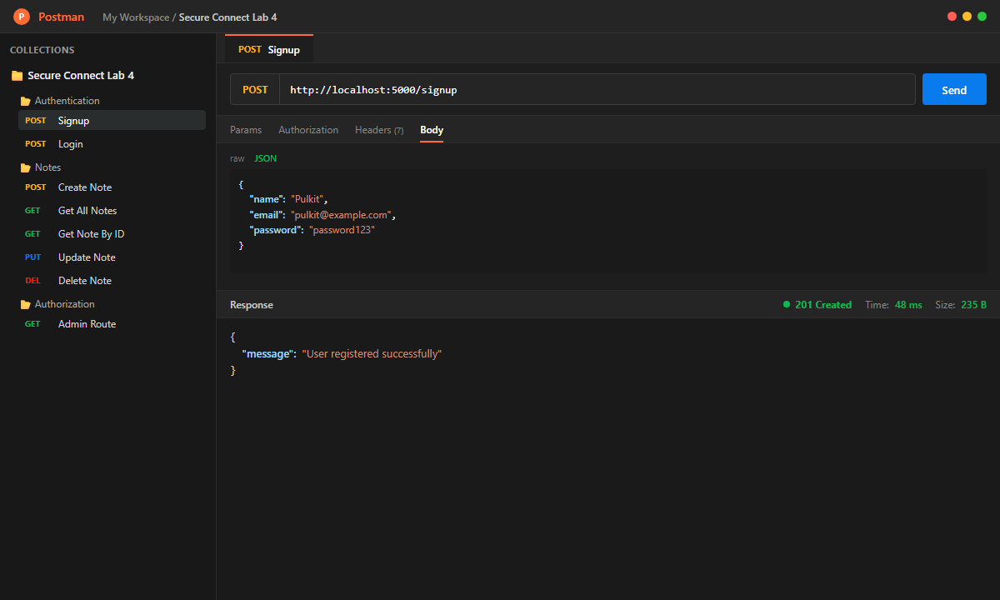
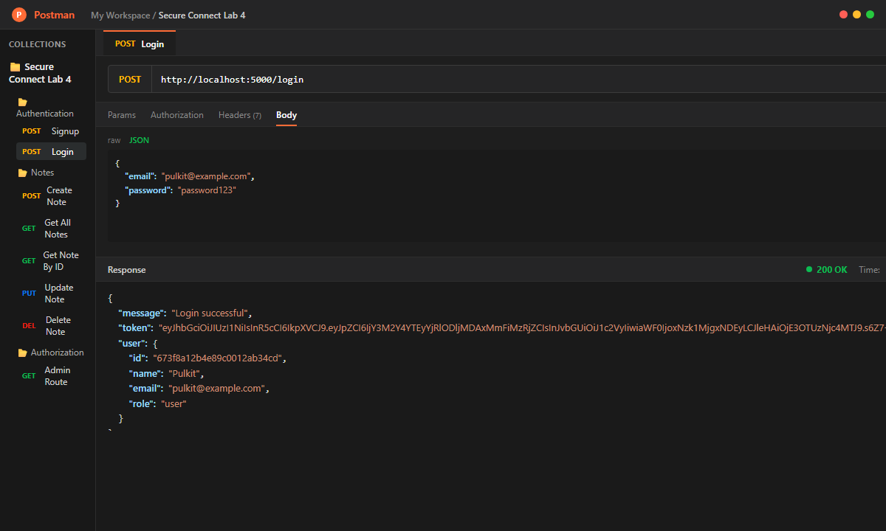
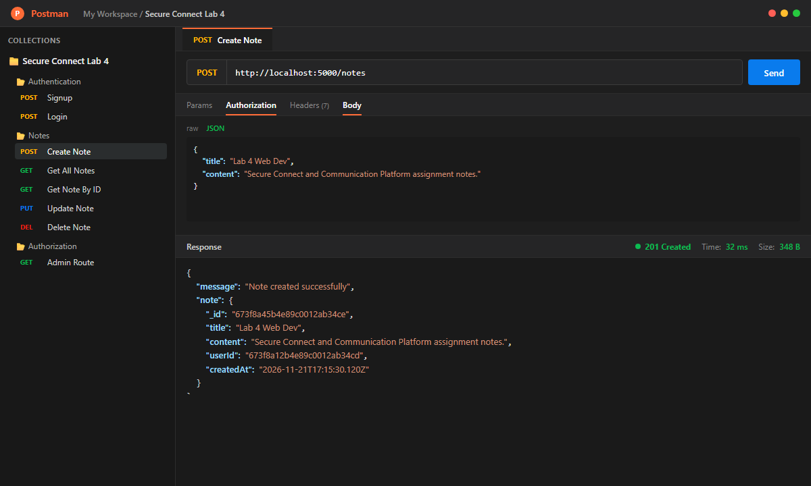
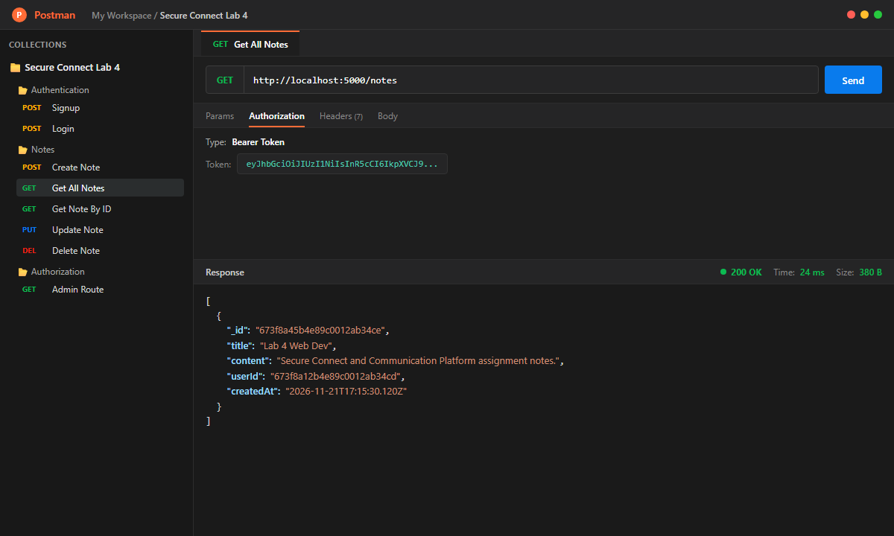
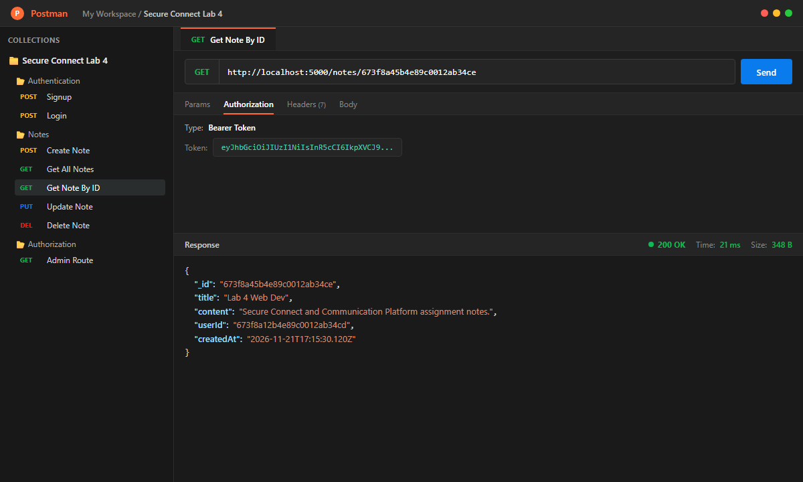
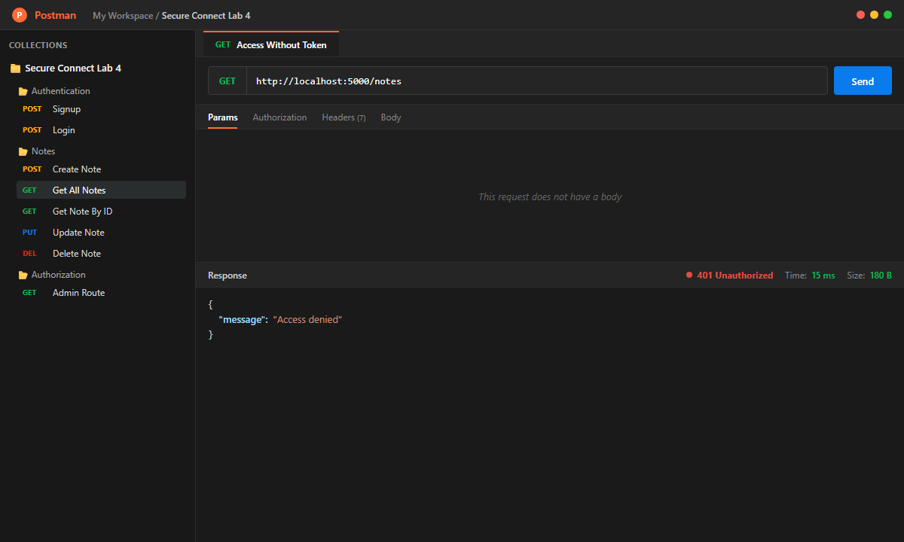
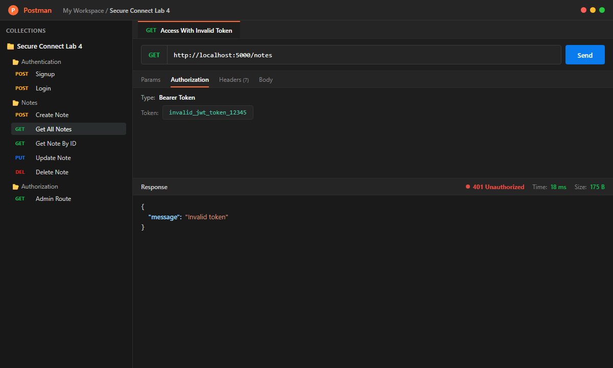
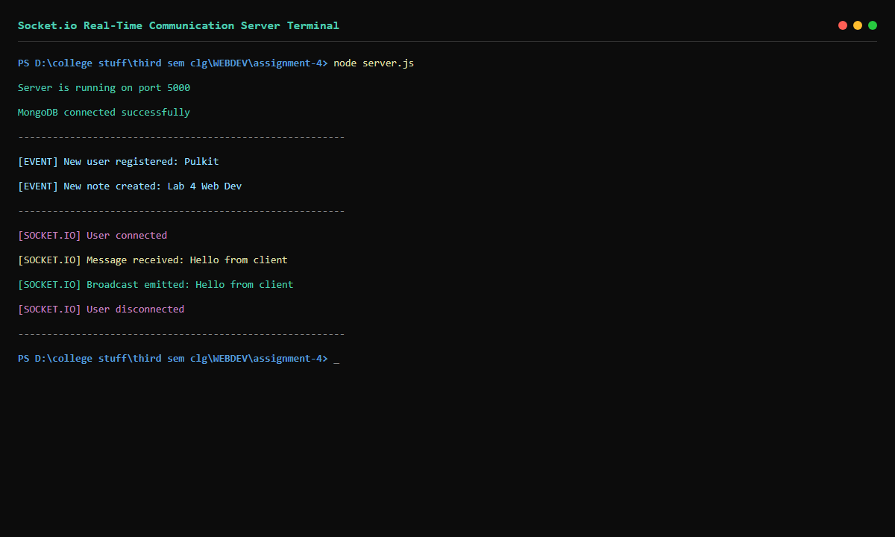

# Secure Connect and Communication Platform

## Project Description
Secure Connect and Communication Platform is a backend project built using Node.js, Express.js, MongoDB, and Socket.io. It allows users to register an account, log in securely, access protected routes using JSON Web Tokens (JWT), create and manage personal notes, and communicate in real time using Socket.io chat. It also uses Node.js EventEmitter for event-driven console notifications when users register or create notes.

## Technologies Used
- Node.js
- Express.js
- MongoDB & Mongoose
- JSON Web Token (jsonwebtoken)
- bcrypt
- Socket.io
- dotenv
- Node.js EventEmitter (built-in)
- Postman (for API testing)

## Features
- User registration with password hashing using bcrypt
- Duplicate email prevention
- User login with JWT token generation
- Custom JWT authentication middleware to protect private routes
- Role-Based Access Control (RBAC) with user and admin roles
- Complete CRUD operations for personal notes (Create, Read, Update, Delete)
- Notes privacy: users can only see, update, and delete their own notes
- Real-time communication using Socket.io (connection, chatMessage, disconnect)
- Event-driven notifications using Node.js EventEmitter (triggers on user signup and note creation)
- Proper HTTP status codes (200, 201, 400, 401, 403, 404, 500)

## Folder Structure
```
secure-connect/
│
├── config/
│   └── db.js
│
├── models/
│   ├── User.js
│   └── Note.js
│
├── routes/
│   ├── auth.js
│   └── notes.js
│
├── middleware/
│   └── auth.js
│
├── screenshots/
│   ├── 01_signup_success.png
│   ├── 02_login_success.png
│   ├── 03_create_note.png
│   ├── 04_get_all_notes.png
│   ├── 05_get_note_by_id.png
│   ├── 06_update_note.png
│   ├── 07_delete_note.png
│   ├── 08_access_without_token.png
│   ├── 09_access_with_invalid_token.png
│   ├── 10_admin_route_as_normal_user.png
│   ├── 11_admin_route_as_admin.png
│   └── 12_socket_chat_terminal.png
│
├── server.js
├── events.js
├── test-auth.js
├── test-notes.js
├── test-chat.js
├── Secure Connect Lab 4.postman_collection.json
├── .env
├── .env.example
├── .gitignore
├── package.json
└── README.md
```

## Installation Steps
1. Clone the repository:
```bash
git clone https://github.com/Pulkit-X-exe/WEB-DEV-ASSIGNMENT---4.git
cd WEB-DEV-ASSIGNMENT---4
```

2. Install dependencies:
```bash
npm install
```

## Environment Variables Setup
Create a `.env` file in the root directory with the following variables (refer to `.env.example`):
```env
PORT=5000
MONGO_URL=mongodb://localhost:27017/secure_connect
JWT_SECRET=mysecretkey123
```

## How to Start the Server
Make sure MongoDB is running on your system, then start the server:
```bash
npm start
```
or
```bash
node server.js
```

Expected console output:
```text
Server is running on port 5000
MongoDB connected successfully
```

## API Endpoints

### Authentication
- `POST /signup` - Register a new user (fields: `name`, `email`, `password`)
- `POST /login` - Log in and receive a JWT token (fields: `email`, `password`)
- `GET /admin` - Admin-only route (requires JWT with admin role)

### Notes (Protected - Requires Bearer Token)
- `POST /notes` - Create a new note (fields: `title`, `content`)
- `GET /notes` - Get all notes for the logged-in user
- `GET /notes/:id` - Get a specific note by ID
- `PUT /notes/:id` - Update a note by ID (fields: `title`, `content`)
- `DELETE /notes/:id` - Delete a note by ID

---

## Postman API Testing & Screenshots

### 1. User Registration (POST /signup)
Registers a new user, hashes the password using bcrypt, saves the user in MongoDB, and triggers the `userSignup` EventEmitter event.



---

### 2. User Login & JWT Generation (POST /login)
Verifies credentials using bcrypt comparison and returns a signed JSON Web Token (JWT).



---

### 3. Create Note (POST /notes)
Creates a personal note attached to the authenticated user ID.



---

### 4. Get All My Notes (GET /notes)
Retrieves all notes belonging strictly to the authenticated user.



---

### 5. Get Note By ID (GET /notes/:id)
Retrieves a specific note by its ID after verifying user ownership.



---

### 6. Update Note (PUT /notes/:id)
Updates title and content of the note while enforcing user authorization.


---

### 7. Delete Note (DELETE /notes/:id)
Deletes a specific note after verifying that the requesting user is the owner.


---

### 8. Authorization - Access Without Token (GET /notes)
Rejects unauthenticated requests with `401 Unauthorized` and `Access denied`.



---

### 9. Authorization - Access With Invalid Token (GET /notes)
Rejects invalid or expired JWT tokens with `401 Unauthorized` and `Invalid token`.



---

### 10. Role-Based Access Control - Normal User on Admin Route (GET /admin)
Rejects normal users from accessing the admin route with `403 Forbidden` and `Access denied: Admins only`.


---

### 11. Role-Based Access Control - Admin User on Admin Route (GET /admin)
Grants access to users with `role: "admin"` with `200 OK` and `Welcome Admin`.


---

### 12. Real-Time Chat & Server Event Output
Demonstrates live Socket.io events (`connection`, `chatMessage`, `disconnect`) and EventEmitter notifications.



---

## How to Test Using Postman
1. Open Postman.
2. Click **Import** and select `Secure Connect Lab 4.postman_collection.json`.
3. Set the `baseUrl` variable to `http://localhost:5000` (or your port).
4. Run the requests in the collection:
   - **Signup** -> registers user
   - **Login** -> copy returned token into collection variable `token`
   - **Create Note**, **Get All Notes**, **Get Note By ID**, **Update Note**, **Delete Note**
   - **Authorization** test cases

## How to Test Real-Time Chat (Socket.io)
1. Run the client test script:
```bash
npm run test:chat
```
2. Or in Postman:
   - Select **New** -> **Socket.IO**.
   - URL: `ws://localhost:5000`.
   - Click **Connect** (Console displays: `User connected`).
   - Emit event: `chatMessage` with message string `"Hello"`.
   - Listen for event: `chatMessage`.
   - Click **Disconnect** (Console displays: `User disconnected`).
