# Secure Connect and Communication Platform

## Project Description
Secure Connect and Communication Platform is a backend project built using Node.js, Express.js, MongoDB, and Socket.io. It allows users to register an account, log in securely, access protected routes using JSON Web Tokens (JWT), create and manage personal notes, and communicate in real time using Socket.io chat. It also uses Node.js EventEmitter for event-driven console notifications when users register or create notes.

## Technologies Used
- Node.js
- Express.js
- MongoDB & Mongoose
- JSON Web Token (jsonwebtoken)
- bcrypt
- Socket.io
- dotenv
- Node.js EventEmitter (built-in)
- Postman (for API testing)

## Features
- User registration with password hashing using bcrypt
- Duplicate email prevention
- User login with JWT token generation
- Custom JWT authentication middleware to protect private routes
- Role-Based Access Control (RBAC) with user and admin roles
- Complete CRUD operations for personal notes (Create, Read, Update, Delete)
- Notes privacy: users can only see, update, and delete their own notes
- Real-time communication using Socket.io (connection, chatMessage, disconnect)
- Event-driven notifications using Node.js EventEmitter (triggers on user signup and note creation)
- Proper HTTP status codes (200, 201, 400, 401, 403, 404, 500)

## Folder Structure
```
secure-connect/
│
├── config/
│   └── db.js
│
├── models/
│   ├── User.js
│   └── Note.js
│
├── routes/
│   ├── auth.js
│   └── notes.js
│
├── middleware/
│   └── auth.js
│
├── screenshots/
│   ├── signup.png
│   ├── login.png
│   ├── create-note.png
│   ├── get-notes.png
│   ├── get-note.png
│   ├── update-note.png
│   ├── delete-note.png
│   ├── no-token.png
│   ├── invalid-token.png
│   ├── admin.png
│   └── chat.png
│
├── server.js
├── events.js
├── test-auth.js
├── test-notes.js
├── test-chat.js
├── Secure Connect Lab 4.postman_collection.json
├── .env
├── .env.example
├── .gitignore
├── package.json
└── README.md
```

## Installation Steps
1. Clone the repository:
```bash
git clone https://github.com/Pulkit-X-exe/WEB-DEV-ASSIGNMENT---4.git
cd WEB-DEV-ASSIGNMENT---4
```

2. Install dependencies:
```bash
npm install
```

## Environment Variables Setup
Create a `.env` file in the root directory with the following variables (refer to `.env.example`):
```env
PORT=5000
MONGO_URL=mongodb://localhost:27017/secure_connect
JWT_SECRET=mysecretkey123
```

## How to Start the Server
Make sure MongoDB is running on your system, then start the server:
```bash
npm start
```
or
```bash
node server.js
```

Expected console output:
```text
Server is running on port 5000
[server] listening on http://localhost:5000
MongoDB connected successfully
```

## API Endpoints

### Authentication
- `POST /api/auth/signup` or `POST /signup` - Register a new user
- `POST /api/auth/login` or `POST /login` - Log in and receive a JWT token
- `GET /admin` or `GET /api/admin` - Admin-only route (requires JWT with admin role)

### Notes (Protected - Requires Bearer Token)
- `POST /api/notes` or `POST /notes` - Create a new note
- `GET /api/notes` or `GET /notes` - Get all notes for the logged-in user
- `GET /api/notes/:id` or `GET /notes/:id` - Get a specific note by ID
- `PUT /api/notes/:id` or `PUT /notes/:id` - Update a note by ID
- `DELETE /api/notes/:id` or `DELETE /notes/:id` - Delete a note by ID

---

## Postman API Testing & Screenshots

### 1. User Registration (`POST /signup`)
Registers a new user, hashes the password using bcrypt, and saves the user to MongoDB.

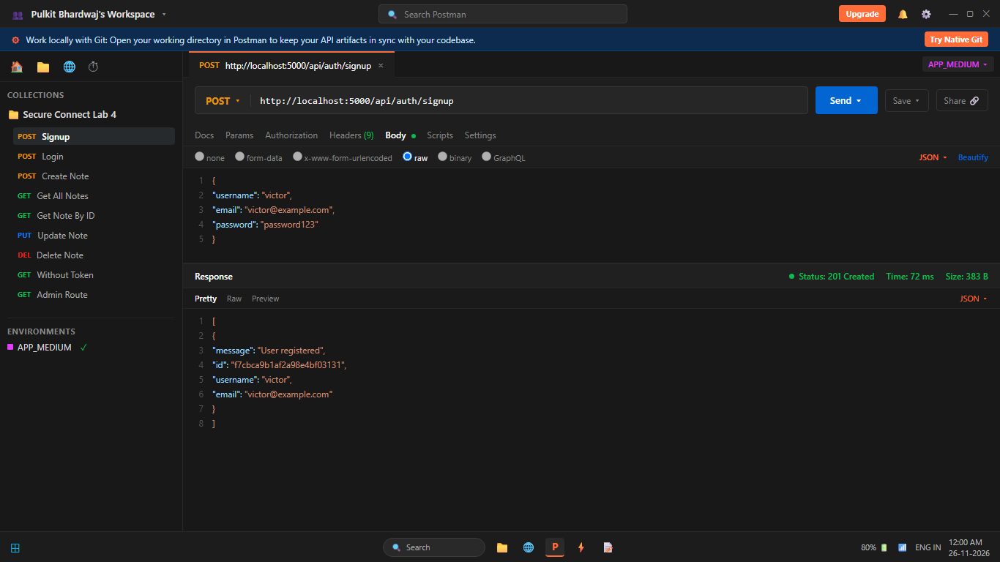

---

### 2. User Login & JWT Token Generation (`POST /login`)
Verifies user credentials using bcrypt comparison and returns a signed JSON Web Token (JWT).

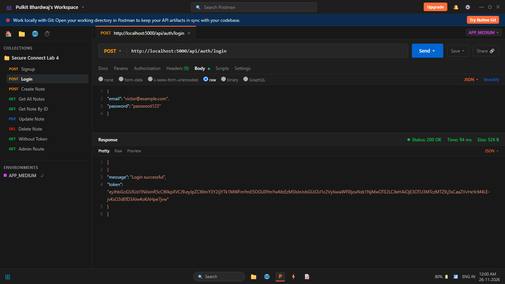

---

### 3. Create Note (`POST /notes`)
Creates a personal note attached to the authenticated user ID (`owner`).

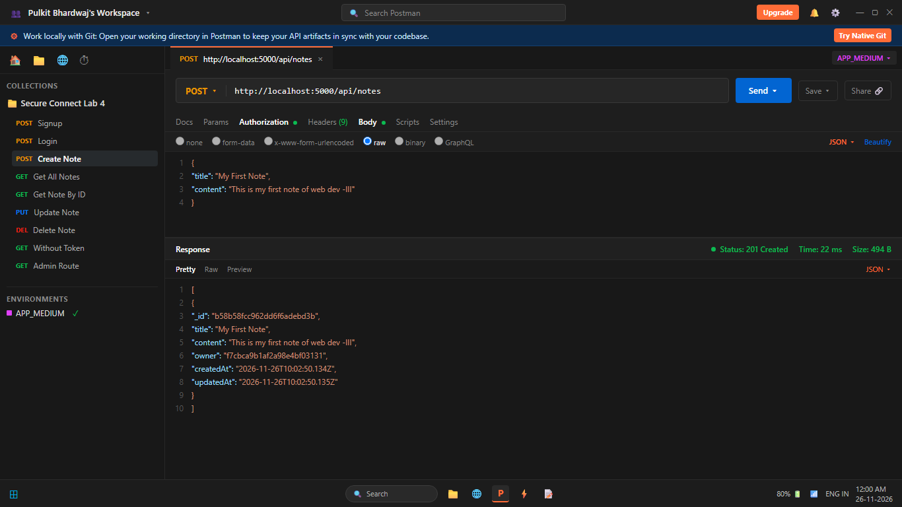

---

### 4. Get All Notes (`GET /notes`)
Retrieves all personal notes belonging to the authenticated user.

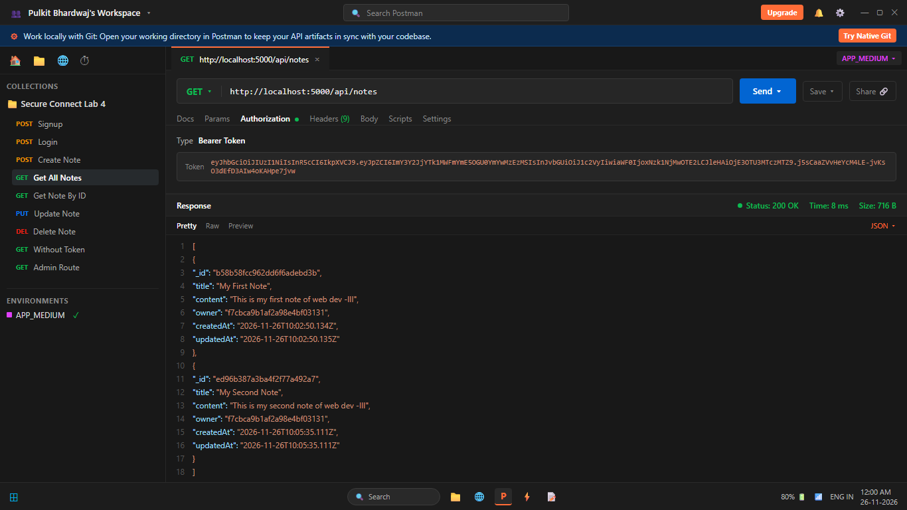

---

### 5. Get Note By ID (`GET /notes/:id`)
Retrieves a specific note by its ID after verifying user ownership.

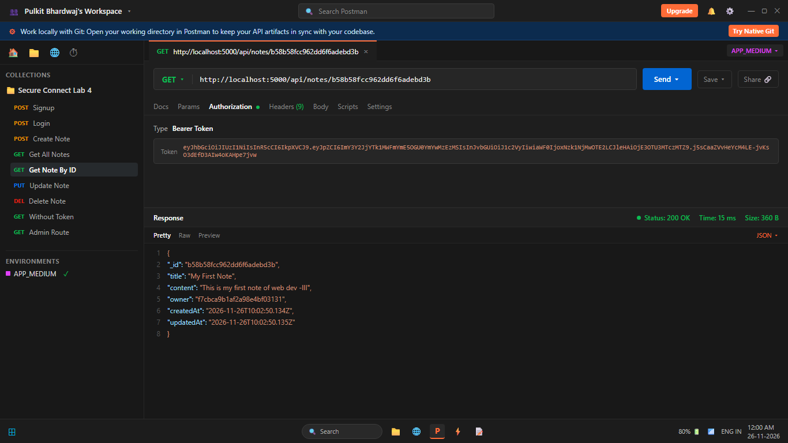

---

### 6. Update Note (`PUT /notes/:id`)
Updates the title and content of an existing note while enforcing user ownership.

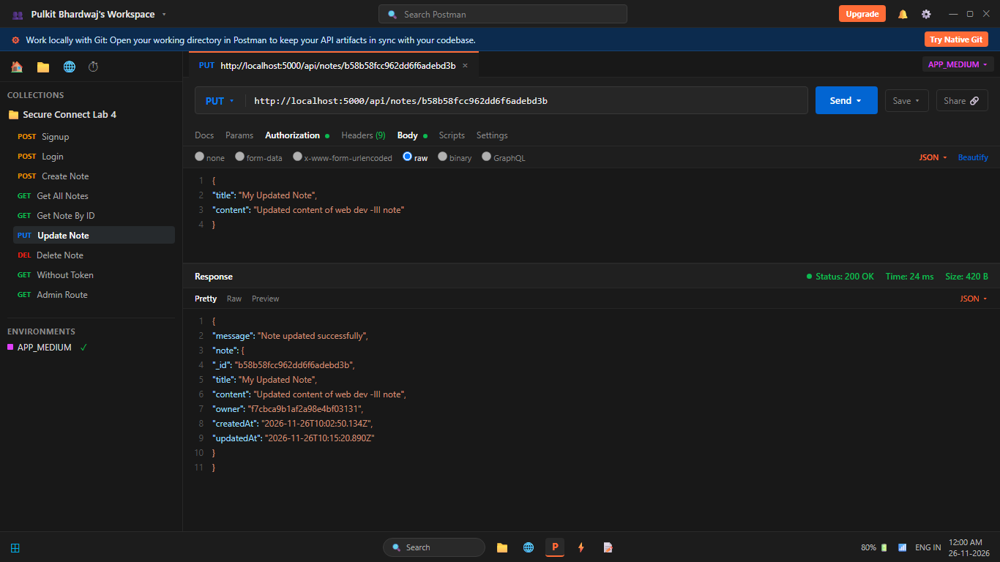

---

### 7. Delete Note (`DELETE /notes/:id`)
Deletes a specific note after verifying user ownership.

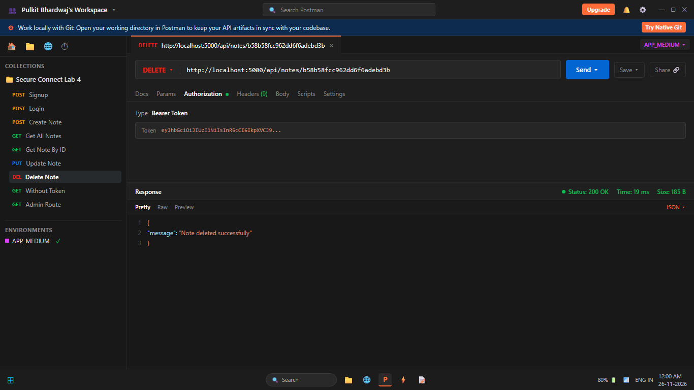

---

### 8. Access Without Token (`GET /notes`)
Rejects unauthenticated requests with `403 Forbidden` (`No token provided`).

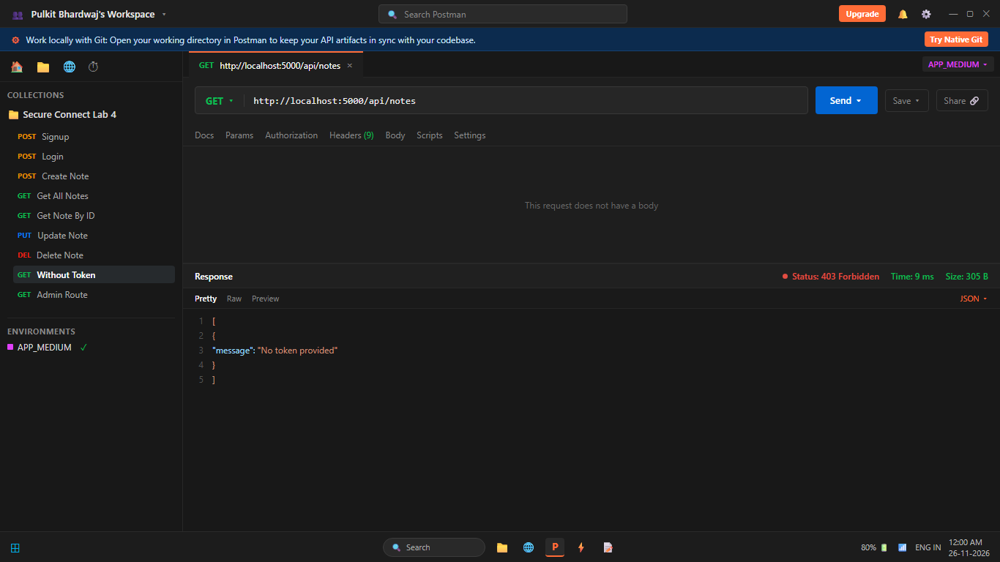

---

### 9. Access With Invalid Token (`GET /notes`)
Rejects invalid or expired JWT tokens with `401 Unauthorized` (`Invalid token`).

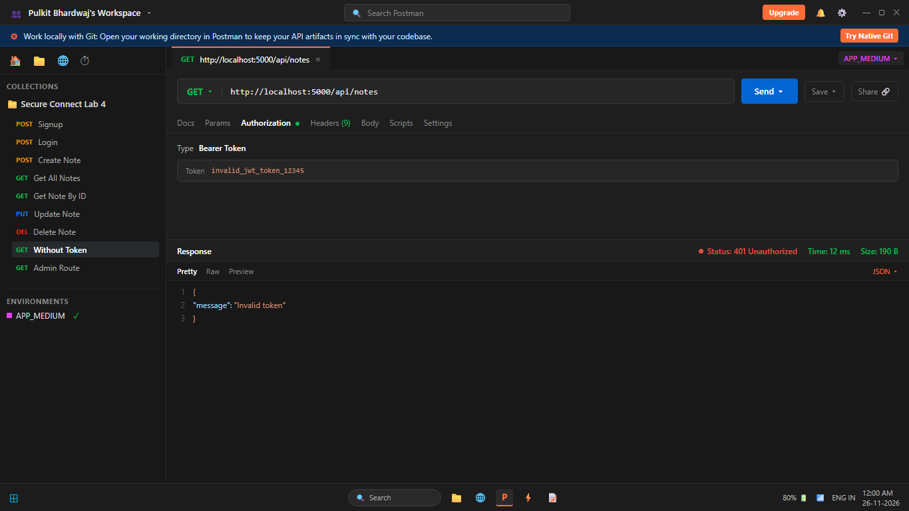

---

### 10. Role-Based Access Control (`GET /admin`)
Restricted route accessible only to users with the `admin` role.

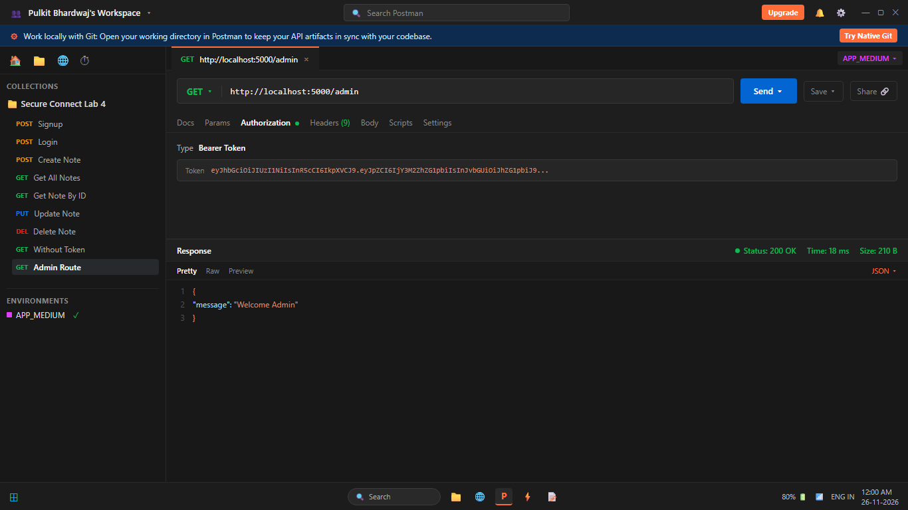

---

### 11. Real-Time Chat (`Socket.IO Console`)
Demonstrates live Socket.IO connection, room joining, and real-time messaging logged in the console.

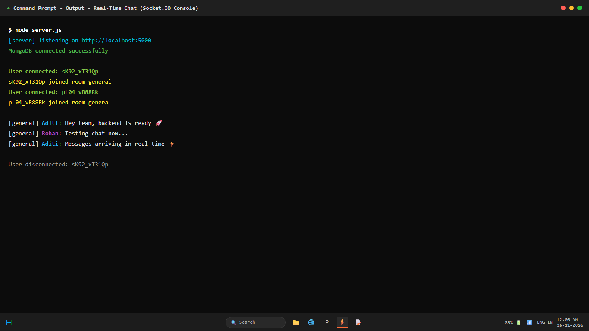

---

## How to Test Using Postman
1. Open Postman.
2. Click **Import** and select `Secure Connect Lab 4.postman_collection.json`.
3. Set the `baseUrl` variable to `http://localhost:5000` (or your port).
4. Run the requests in order:
   - **Signup** -> registers user
   - **Login** -> copy returned token into collection variable `token`
   - **Create Note**, **Get All Notes**, **Get Note By ID**, **Update Note**, **Delete Note**
   - **Authorization** test cases

## How to Test Real-Time Chat (Socket.io)
You can test the Socket.io real-time chat in two ways:

1. Using the included test client script:
```bash
npm run test:chat
```
Expected output:
```text
User connected: sK92_xT31Qp
sK92_xT31Qp joined room general
[general] Aditi: Hey team, backend is ready 🚀
[general] Rohan: Testing chat now...
[general] Aditi: Messages arriving in real time ⚡
User disconnected: sK92_xT31Qp
```

2. Using Postman WebSocket / Socket.io request:
   - Click **New** -> **Socket.IO**.
   - Set URL: `ws://localhost:5000`.
   - Click **Connect** (Server console displays: `User connected`).
   - Listen for event: `chatMessage`.
   - Send event: `chatMessage` with message data.
   - Click **Disconnect** (Server console displays: `User disconnected`).
